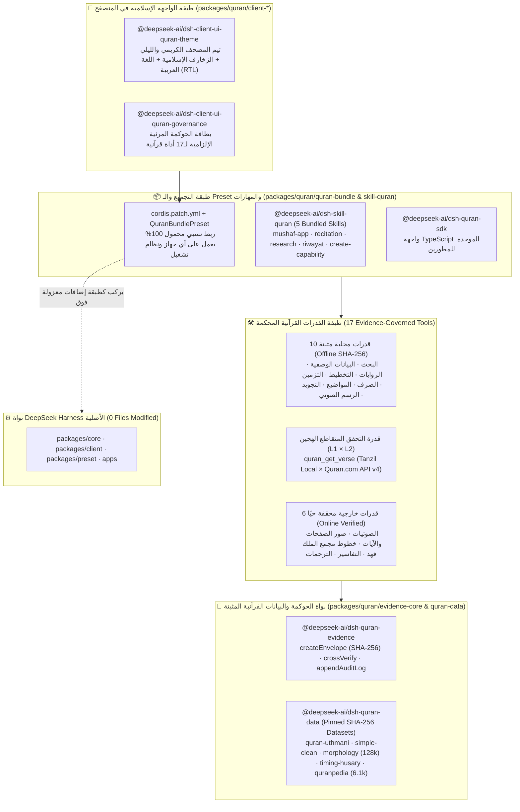

<div align="center">


# 🕌 DeepSeek Quran Harness · المصحف الذكي الموثق بالأدلة

**منظومة الوكيل القرآني الموثق بالأدلة التشفيرية (`SHA-256`) والتحقق المتقاطع الإلزامي فوق DeepSeek Harness**

[](./docs/quran/RELEASE-v0.1.0.md)
[](./packages/quran)
[](#3-كتالوج-القدرات-القرآنية-الـ17--the-17-governed-capabilities)
[](#4-المهارات-القرآنية-الـ5--the-5-bundled-skills)
[](#6-إجراء-الاختبارات-الشاملة--running-all-tests)
[](#1-المعمارية-كطبقة-معزولة--isolated-layer-architecture)

🌐 **[صفحة المواصفات التفاعلية الكاملة (Interactive Showcase)](https://barniyah.github.io/Quran-Harness/)** · 🧪 **[دليل اختبارات الواجهة (GUI Test Suite)](./docs/quran/QURAN-HARNESS-GUI-TESTS.md)** · 🛠️ **[دليل مطوري الإضافات (Developer Guide)](./docs/quran/DEVELOPER-PLUGIN-GUIDE.md)** · 📦 **[دليل الـ SDK والمهارات](./docs/quran/SDK-AND-SKILLS-GUIDE.md)**

</div>

---

## نبذة عن المشروع · Overview

**DeepSeek Quran Harness** هو منظومة هندسية متكاملة تحوّل منصة **DeepSeek Harness (DSH)** إلى بيئة تطوير وبحث قرآني موثقة بالأدلة التشفيرية (**SHA-256**)، مبنية بالكامل كـ **طبقة إضافات معزولة 100%** داخل المسار `packages/quran/*` دون تعديل ملف واحد من نواة DSH الأصلية (`0` files modified in `packages/core`, `packages/client`, `packages/preset`, `apps`).

صُمم المشروع ليقضي جذريًا على مشكلة "هلوسة النماذج اللغوية" في النصوص القرآنية والتفسير وعلوم القرآن عبر فرض **أربع قواعد حوكمة صارمة**:
1. **حظر الاقتباس من ذاكرة النموذج اللغوي (Zero LLM Memory Recall):** يُمنع الوكيل قطعيًا من كتابة أي آية من ذاكرته؛ كل آية يجب أن تمر عبر أداة `quran_get_verse`.
2. **التحقق المتقاطع المزدوج الحي (Mandatory Dual-Source Cross-Verification):** تقارن أداة `quran_get_verse` النص العثماني المثبت محليًا من **Tanzil Uthmani (`L1-official`)** مع **Quran.com API v4 (`L2-verified-open`)** حرفًا بحرف، وتحجب العرض فورًا عند وجود أي تعارض.
3. **مظروف الأدلة التشفيري (`EvidenceEnvelope` + `SHA-256`):** كل أداة قرآنية تغلّف مخرجاتها بمظروف يحتوي على معرف المصدر، مستوى الموثوقية (`L1` / `L2` / `L3`)، بصمة `SHA-256`، وطابع الوقت، وتدوّنه في سجل التدقيق التراكمي `evidence-audit.jsonl`.
4. **بطاقة الحوكمة المرئية الإلزامية (`GovernanceCard`):** تعرض الواجهة الرسومية للمتصفح بطاقة حوكمة إسلامية تلقائية أسفل كل أداة قرآنية توضح المصدر والبصمة وحكم التحقق.

---

## 1. المعمارية كطبقة معزولة · Isolated Layer Architecture



---

## 2. البيانات القرآنية المحلية المضمّنة في المستودع · Included Pinned Datasets

يحتوي المستودع في المسار [`packages/quran/quran-data/data/`](./packages/quran/quran-data/data) على جميع قواعد البيانات المحلية الخمس مع ملفات البصمات التشفيرية `.sha256` التي يتم فحصها برمجيًا قبل أي قراءة:

| الملف المحلي | البصمة المرافقة | الوصف والحجم | مستوى الثقة |
|---|---|---|---|
| `quran-uthmani.txt` | `quran-uthmani.sha256` | النص القرآني الكامل بالرسم العثماني (رواية حفص عن عاصم — 6,236 آية من Tanzil) | `L1-official` |
| `quran-simple-clean.txt` | `quran-simple-clean.sha256` | النص الإملائي المبسّط للفهرسة والبحث الهيكلي السريع | `L1-official` |
| `quran-morphology.txt` | `quran-morphology.sha256` | مدونة التحليل الصرفي والنحوي والجذور (128,219 مقطعًا من Quranic Arabic Corpus v0.4) | `L2-verified-open` |
| `timing-husary.json` | `timing-husary.sha256` | تزمين الآيات بالمللي ثانية لتلاوة الشيخ محمود خليل الحصري (EveryAyah) | `L1-official` |
| `quranpedia-topics.json` | `quranpedia-topics.sha256` | كتالوج الموضوعات والمفاهيم القرآنية المصنفة (6,100 موضوع من Quranpedia) | `L2-verified-open` |

---

## 3. كتالوج القدرات القرآنية الـ17 · The 17 Governed Capabilities

| # | اسم الأداة (Tool) | الحزمة في `packages/quran/` | نوع المصدر | الوظيفة |
|---|---|---|---|---|
| 1 | `quran_get_verse` | `tool-quran-text` | **هجين (`L1 × L2`)** | جلب نص الآية بالرسم العثماني بعد مطابقة Tanzil المحلي مع Quran.com API v4 |
| 2 | `quran_get_metadata` | `tool-quran-metadata` | **محلي بالكامل** | بيانات السورة والآية والصفحة والجزء والحزب والربع من `quran-meta` |
| 3 | `quran_search` | `tool-quran-search` | **محلي بالكامل (`SHA-256`)** | بحث هيكلي أو حرفي في 6,236 آية مع إرجاع النص العثماني الأصلي |
| 4 | `quran_compare_riwayat` | `tool-quran-riwayat` | **محلي بالكامل** | مقارنة عدّ الآيات ومواضع الصفحات والأجزاء عبر 8 روايات معتمدة |
| 5 | `quran_convert_ayah` | `tool-quran-riwayat` | **محلي بالكامل** | تحويل إحداثيات الآية بين أي روايتين (مثل حفص `2:255` ↔ ورش `2:253`) |
| 6 | `quran_get_page_layout` | `tool-mushaf-layout` | **محلي بالكامل** | نطاقات السور والآيات في صفحات مصحف المدينة الـ604 |
| 7 | `quran_get_ayah_timing` | `tool-quran-timing` | **محلي بالكامل (`SHA-256`)** | تزمين البداية والنهاية والمدة بالمللي ثانية لتلاوة الشيخ الحصري |
| 8 | `quran_get_ayah_morphology` | `tool-quran-linguistics` | **محلي بالكامل (`SHA-256`)** | التحليل الصرفي والنحوي والجذر والوزن لكل كلمة (128,219 مقطعًا) |
| 9 | `quran_search_topics` | `tool-quran-sciences` | **محلي بالكامل (`SHA-256`)** | البحث في الفهرس الموضوعي لعلوم القرآن (6,100 موضوع) |
| 10 | `quran_analyze_tajweed` | `tool-tajweed` | **محلي بالكامل (`.venv`)** | تحليل أحكام التجويد حرفًا بحرف خوارزميًا عبر `tajweed-embeddings` |
| 11 | `quran_phonetize` | `tool-quran-phonetic` | **محلي بالكامل (`.venv`)** | تحويل الآية إلى الرسم الصوتي المنطوق وجدول صفات الحروف عبر `quran-transcript` |
| 12 | `quran_get_audio` | `tool-quran-audio` | **خارجي + فحص `HEAD`** | روابط التلاوة لـ5 قرّاء معتمدين من EveryAyah مع فحص توافر حي |
| 13 | `quran_get_page_image` | `tool-mushaf-images` | **خارجي + فحص `HEAD`** | صور صفحات مصحف المدينة الـ604 من مجمع الملك فهد مع فحص حي |
| 14 | `quran_get_ayah_image` | `tool-mushaf-images` | **خارجي + فحص `HEAD`** | صورة PNG شفافة للآية المفردة من EveryAyah مع فحص حي |
| 15 | `quran_get_fonts` | `tool-quran-fonts` | **خارجي + فحص `HEAD`** | روابط خطوط مجمع الملك فهد الرسمية (`KFGQPC`) لحفص وورش وقالون والدوري |
| 16 | `quran_get_tafsir` | `tool-quran-tafsir` | **خارجي محقق (`SHA-256`)** | التفاسير المعتمدة المنسوبة (ابن كثير، الطبري، القرطبي، السعدي، الميسر) |
| 17 | `quran_get_translation` | `tool-quran-translations` | **خارجي محقق (`SHA-256`)** | ترجمات معاني القرآن المعتمدة مع نسبة المترجم الصريحة |

---

## 4. المهارات القرآنية الـ5 · The 5 Bundled Skills

تُشحن الحزمة [`@deepseek-ai/dsh-skill-quran`](./packages/quran/skill-quran) بخمس مهارات قياسية:
1. **`quran-mushaf-app`**: بناء تطبيقات عرض المصحف الموثقة باستخدام `@deepseek-ai/dsh-quran-sdk` وخطوط مجمع الملك فهد.
2. **`quran-recitation-feature`**: بناء مشغلات التلاوة المتزامنة بالمللي ثانية مع تلوين التجويد الخوارزمي والرسم الصوتي.
3. **`quran-verified-research`**: إعداد الأبحاث القرآنية الموثقة (بحث + صرف وجذور + مواضيع + تفاسير مسماة + سجل أدلة `SHA-256`).
4. **`quran-compare-riwayat`**: المقارنة الهيكلية وتحويل عدّ الآيات بين الروايات الثمان المعتمدة.
5. **`quran-create-capability`**: إنشاء قدرة أو مهارة قرآنية جديدة وربطها **تلقائيًا** بطبقة الحوكمة (`EvidenceEnvelope` + `GovernanceCard` + `cordis.patch.yml`).

---

## 5. التثبيت والتشغيل المستقل · Installation & Standalone Execution

### المتطلبات الأساسية (Prerequisites)
- **Node.js**: الإصدار `22.19.0+` أو `24.0.0+`
- **pnpm**: الإصدار `10+` أو `11+`
- **Python 3.10+** (اختياري — لتشغيل محركي التجويد `tajweed-embeddings` والرسم الصوتي `quran-transcript` محليًا)

### خطوات التنزيل والإعداد والتشغيل على Windows

```powershell
# 1. استنساخ المستودع
git clone https://github.com/Barniyah/Quran-Harness.git
cd Quran-Harness

# 2. تشغيل سكربت الإعداد الشامل (يثبّت الحزم + يبني المشروع + يجهّز بيئة بايثون .venv)
.\setup-quran-harness.cmd

# 3. تشغيل الواجهة الرسومية الكاملة لـ Quran Harness
.\run-quran-harness.cmd
```

### خطوات التنزيل والإعداد والتشغيل على macOS / Linux

```bash
# 1. استنساخ المستودع
git clone https://github.com/Barniyah/Quran-Harness.git
cd Quran-Harness

# 2. تشغيل سكربت الإعداد الشامل
chmod +x setup-quran-harness.sh run-quran-harness.sh
./setup-quran-harness.sh

# 3. تشغيل الواجهة الرسومية الكاملة لـ Quran Harness
./run-quran-harness.sh
```

> **ملاحظة:** يمكنك أيضًا تمرير أي خيارات إضافية لسكربت التشغيل مثل تحديد المنفذ:
> `.\run-quran-harness.cmd --port 3000`

---

## 6. إجراء الاختبارات الشاملة · Running All Tests

يحتوي المشروع على **21 ملف اختبار آلي (95 اختبارًا)** تغطي جميع القدرات الـ17، المهارات الـ5، الـ SDK، الثيم الإسلامي واللغة العربية (`RTL`)، وبوابات التحقق النهائية واختبارات Red-Team:

```bash
# 1. تشغيل جميع الاختبارات في packages/quran (21 ملف اختبار — 95 اختبارًا)
pnpm exec vitest run packages/quran

# 2. تشغيل بوابات التحقق النهائية وعزل النواة واختبارات Red-Team منفردةً
pnpm exec vitest run packages/quran/quran-bundle/tests/phase5-release-verification.spec.ts

# 3. تشغيل اختبارات الثيم الإسلامي واللغة العربية (RTL)
pnpm exec vitest run packages/quran/client-theme-islamic/tests/theme.client.spec.ts
```

ولاختبار جميع القدرات والمهارات يدويًا داخل الواجهة الرسومية للمتصفح، راجع:
- 📄 **[دليل اختبارات الواجهة الكامل (Markdown)](./docs/quran/QURAN-HARNESS-GUI-TESTS.md)**
- 🌐 **[صفحة اختبارات الواجهة التفاعلية القابلة للنسخ (HTML)](./docs/quran/QURAN-HARNESS-GUI-TESTS.html)**

---

## 7. كيفية إضافة قدرة قرآنية جديدة وربطها بالحوكمة تلقائيًا · Adding a New Capability

يمكنك إنشاء أي قدرة قرآنية جديدة وربطها تلقائيًا بطبقة الحوكمة بطريقتين:

### أ) من خلال المحادثة مباشرة (عبر مهارة `quran-create-capability`)
اكتب للوكيل في المحادثة:
> `استخدم مهارة quran-create-capability لإنشاء قدرة قرآنية جديدة باسم quran_get_sajdah_verses تعرض آيات السجدة في القرآن، واربطها تلقائيًا بمظروف الأدلة EvidenceEnvelope وبطاقة GovernanceCard وملف cordis.patch.yml.`

### ب) من خلال المولّد الآلي في الطرفية (`scripts/create-quran-capability.mjs`)
```bash
node scripts/create-quran-capability.mjs \
  --pkg tool-quran-sajdah \
  --tool quran_get_sajdah_verses \
  --source-id tanzil-sajdah \
  --source-name "Tanzil Verified Sajdah Verses" \
  --trust L1-official \
  --description "Retrieve verified Sajdah verses in Hafs with governance envelope"
```
يقوم هذا المولّد تلقائيًا بـ:
1. إنشاء الحزمة `packages/quran/tool-quran-sajdah/` مع فحص إحداثيات الآيات وبناء `EvidenceEnvelope` (`SHA-256`) والتدوين في `evidence-audit.jsonl`.
2. تسجيل الأداة `quran_get_sajdah_verses` في [`packages/quran/client-governance-card/src/client/index.ts`](./packages/quran/client-governance-card/src/client/index.ts).
3. إضافة الحزمة بمسار نسبي محمول في [`packages/quran/quran-bundle/cordis.patch.yml`](./packages/quran/quran-bundle/cordis.patch.yml).

---

<div align="center">

### 🏛️ إعداد وتطوير ومعمارية المشروع · Author & Architect

**Mohammed Barniyah · محمد برنيه**

[](https://www.linkedin.com/in/barniyah)
[](https://github.com/Barniyah)

`۞  ━━━━━━━  ۞  ━━━━━━━  ۞  QURAN HARNESS · v0.1.0  ۞  ━━━━━━━  ۞  ━━━━━━━  ۞`

</div>
