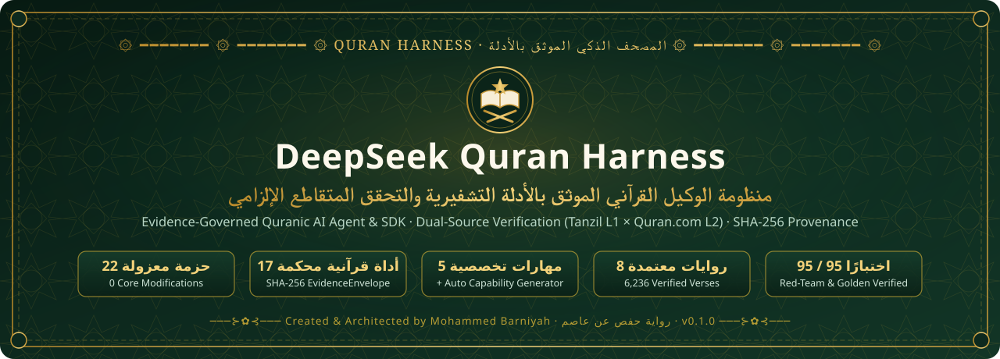
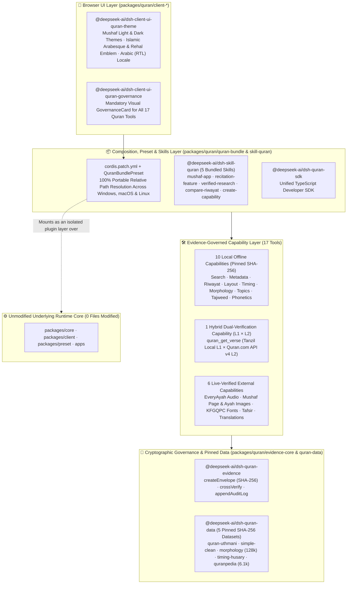
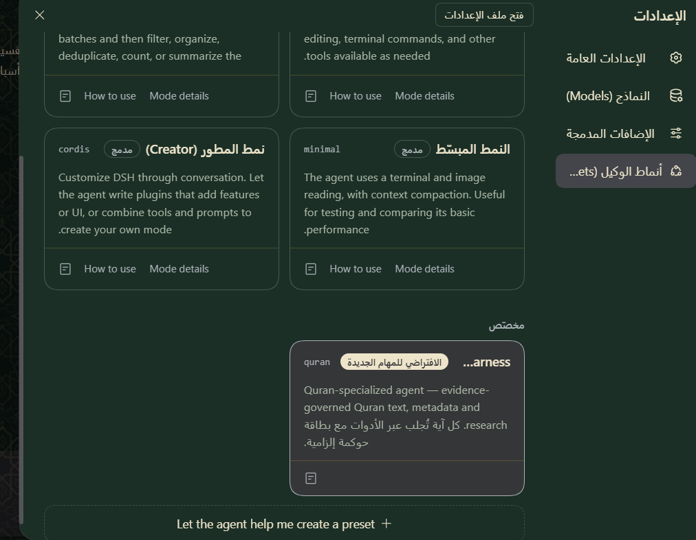
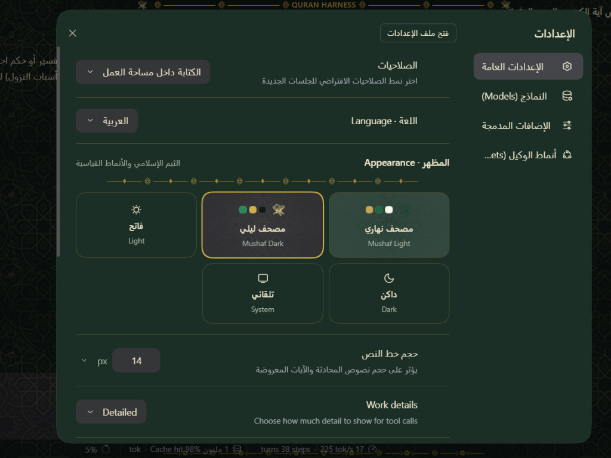

<div align="center">



# 🕌 Quran Harness

**Evidence-Governed Quranic AI Agent, Developer SDK, and Scholarly Research Suite (`SHA-256` Provenance)**

[](https://github.com/Barniyah/Quran-Harness/releases/tag/quran-harness-v0.1.0)
[](./packages/quran)
[](#3-the-17-evidence-governed-capabilities)
[](#4-the-5-bundled-skills)
[](#6-running-the-verification--test-suite)
[](#1-isolated-layer-architecture)

🌐 **[Interactive Arabic & Technical Showcase (GitHub Pages)](https://barniyah.github.io/Quran-Harness/)** · 🧪 **[Interactive GUI Test Suite](https://barniyah.github.io/Quran-Harness/quran/QURAN-HARNESS-GUI-TESTS.html)** · 🛠️ **[Developer Plugin Guide](./docs/quran/DEVELOPER-PLUGIN-GUIDE.md)** · 📦 **[SDK & Skills Reference](./docs/quran/SDK-AND-SKILLS-GUIDE.md)** · 🤝 **[Contributing Guide](./CONTRIBUTING.md)**

</div>

---

## Overview

**Quran Harness** is a comprehensive, evidence-governed engineering and scholarly research suite designed for building verifiable Quranic applications and conducting rigorous Quranic studies. It is architected as a **100% isolated plugin layer** inside `packages/quran/*` (`22` modular packages) with **zero modifications** to the underlying host runtime (`0` files modified in `packages/core`, `packages/client`, `packages/preset`, or `apps`).

To eliminate Large Language Model (LLM) hallucination when handling sacred Quranic text, **Quran Harness** enforces **four iron governance gates**:

1. **Zero LLM Memory Recall:** The agent is strictly prohibited from quoting, paraphrasing, or recalling Quranic verses from model memory. Every verse must be retrieved through the `quran_get_verse` tool.
2. **Mandatory Dual-Source Cross-Verification (`L1 × L2`):** `quran_get_verse` cross-verifies the local SHA-256-pinned **Tanzil Uthmani (`L1-official`)** artifact against **Quran.com API v4 (`L2-verified-open`)** character by character. Any discrepancy blocks display immediately.
3. **Cryptographic `EvidenceEnvelope` (`SHA-256`):** Every Quranic tool wraps its output in a tamper-evident `EvidenceEnvelope` containing the source descriptor, trust tier (`L1-official`, `L2-verified-open`, `L3-community`), canonical `SHA-256` `contentHash`, `retrievedAt` timestamp, and algorithmic `transforms`, while recording every operation in an append-only `evidence-audit.jsonl` ledger.
4. **Mandatory Browser `GovernanceCard`:** The web UI automatically renders a visual Islamic Governance Card beneath every Quran tool invocation, displaying the reference, source provenance, SHA-256 digest, and verification verdict.

---

## 1. Isolated Layer Architecture

All Quran Harness functionality lives inside `packages/quran/*` and mounts declaratively via [`packages/quran/quran-bundle/cordis.patch.yml`](./packages/quran/quran-bundle/cordis.patch.yml) using portable relative module resolution (`./lib/index.js` and `../<pkg>/lib/index.js`).



---

## 2. Pinned Local Quranic Datasets Included in Repository

All five local Quranic datasets and their `.sha256` cryptographic sidecar files are committed directly inside [`packages/quran/quran-data/data/`](./packages/quran/quran-data/data) and verified prior to every read operation:

| Local Data File | SHA-256 Sidecar | Contents & Scale | Trust Tier |
|---|---|---|---|
| `quran-uthmani.txt` | `quran-uthmani.sha256` | Complete Uthmani Quran text (Hafs 'an 'Asim — 6,236 verses from Tanzil) | `L1-official` |
| `quran-simple-clean.txt` | `quran-simple-clean.sha256` | Clean Imla'ei skeleton index for fast offline structural search | `L1-official` |
| `quran-morphology.txt` | `quran-morphology.sha256` | Quranic Arabic Corpus v0.4 morphological & syntactic segments (128,219 segments) | `L2-verified-open` |
| `timing-husary.json` | `timing-husary.sha256` | Millisecond-level ayah recitation timings for Sheikh Mahmoud Khalil Al-Husary | `L1-official` |
| `quranpedia-topics.json` | `quranpedia-topics.sha256` | Categorized Quranic concepts and thematic index (6,100 topics from Quranpedia) | `L2-verified-open` |

---

## 3. The 17 Evidence-Governed Capabilities

| # | Tool Name | Package (`packages/quran/`) | Data Source Type | Description |
|---|---|---|---|---|
| 1 | `quran_get_verse` | `tool-quran-text` | **Hybrid (`L1 × L2`)** | Retrieves Uthmani verse text after mandatory cross-verification between pinned Tanzil (`L1`) and Quran.com API v4 (`L2`) |
| 2 | `quran_get_metadata` | `tool-quran-metadata` | **Local Offline** | Structural metadata (Surah name, Makki/Madani, verse count, page, Juz, Hizb, Rub') via `quran-meta` |
| 3 | `quran_search` | `tool-quran-search` | **Local Offline (`SHA-256`)** | Skeleton & exact search across all 6,236 verses returning verified Uthmani script |
| 4 | `quran_compare_riwayat` | `tool-quran-riwayat` | **Local Offline** | Compares verse counts, page/Juz positions, and global ayah IDs across 8 canonical riwayat |
| 5 | `quran_convert_ayah` | `tool-quran-riwayat` | **Local Offline** | Converts verse coordinates accurately across riwayat (e.g., Ayat al-Kursi: Hafs `2:255` ↔ Warsh `2:253`) |
| 6 | `quran_get_page_layout` | `tool-mushaf-layout` | **Local Offline** | Surah and ayah range layout for all 604 pages of the Medina Mushaf |
| 7 | `quran_get_ayah_timing` | `tool-quran-timing` | **Local Offline (`SHA-256`)** | Millisecond start, end, and duration timings for Sheikh Al-Husary's murattal recitation |
| 8 | `quran_get_ayah_morphology` | `tool-quran-linguistics` | **Local Offline (`SHA-256`)** | Word-by-word morphological segmentation, POS tags, lemmas, and Arabic roots (128,219 segments) |
| 9 | `quran_search_topics` | `tool-quran-sciences` | **Local Offline (`SHA-256`)** | Thematic search across 6,100 categorized Quranic topics (`quranpedia-topics.json`) |
| 10 | `quran_analyze_tajweed` | `tool-tajweed` | **Local Offline (`.venv`)** | Deterministic character-level Tajweed rule extraction via `tajweed-embeddings` (no probabilistic ML) |
| 11 | `quran_phonetize` | `tool-quran-phonetic` | **Local Offline (`.venv`)** | Converts Uthmani script into Hafs phonetic transcription and per-letter articulation attributes (`sifat`) via `quran-transcript` |
| 12 | `quran_get_audio` | `tool-quran-audio` | **External + Live `HEAD`** | Verified MP3 recitation URLs for 5 canonical reciters from EveryAyah with live HTTP `HEAD` availability probing |
| 13 | `quran_get_page_image` | `tool-mushaf-images` | **External + Live `HEAD`** | High-resolution Medina Mushaf page images (1–604) with live HTTP `HEAD` verification |
| 14 | `quran_get_ayah_image` | `tool-mushaf-images` | **External + Live `HEAD`** | Transparent PNG image URLs for individual verses with live HTTP `HEAD` verification |
| 15 | `quran_get_fonts` | `tool-quran-fonts` | `External + Live HEAD` | Official King Fahd Glorious Quran Printing Complex (`KFGQPC`) TTF/OTF/WOFF2 fonts for Hafs, Warsh, Qalun, and Douri |
| 16 | `quran_get_tafsir` | `tool-quran-tafsir` | **External Verified (`SHA-256`)** | Named classical and contemporary Tafsir editions (Ibn Kathir, Al-Tabari, Al-Qurtubi, Al-Sa'di, Al-Muyassar) |
| 17 | `quran_get_translation` | `tool-quran-translations` | **External Verified (`SHA-256`)** | Attributed translations of Quranic meanings (e.g., Abdel Haleem, Saheeh International) with explicit translator attribution |

---

## 4. The 5 Bundled Skills

The [`@deepseek-ai/dsh-skill-quran`](./packages/quran/skill-quran) package ships five specialized skills:

1. **`quran-mushaf-app`**: Architectural workflow for building evidence-governed Mushaf reader UIs using `@deepseek-ai/dsh-quran-sdk`, `verifyEnvelopeIntegrity`, and KFGQPC typography.
2. **`quran-recitation-feature`**: Building synchronized recitation players combining EveryAyah audio, Husary millisecond timing, algorithmic Tajweed highlighting, and phonetic script.
3. **`quran-verified-research`**: Conducting scholarly Quranic research combining search, morphological root analysis, thematic topics, and named Tafsir with a trailing SHA-256 Evidence Ledger.
4. **`quran-compare-riwayat`**: Structural comparison and coordinate conversion across the 8 canonical riwayat (`Hafs`, `Warsh`, `Qalun`, `Shuba`, `Douri`, `Sousi`, `Bazzi`, `Qunbul`).
5. **`quran-create-capability`**: Scaffolding a new Quran capability (tool or skill) and **automatically wiring it** into the 3-layer Governance Pipeline (`EvidenceEnvelope` + `GovernanceCard` + `cordis.patch.yml`).

---

## 5. Installation & Standalone Execution

### Prerequisites
- **Node.js**: `>= 22.19.0` or `>= 24.0.0`
- **pnpm**: `>= 10.0.0`
- **Python 3.10+** *(optional — automatically configured in `.venv` for local offline Tajweed and Phonetics)*

### Windows — Clone, Setup & Run

```powershell
# 1. Clone the repository
git clone https://github.com/Barniyah/Quran-Harness.git
cd Quran-Harness

# 2. Run the one-step setup script (installs pnpm packages, builds host/client bundles, and sets up Python .venv)
.\setup-quran-harness.cmd

# 3. Launch the standalone Quran Harness Web GUI
.\run-quran-harness.cmd
```

### macOS / Linux — Clone, Setup & Run

```bash
# 1. Clone the repository
git clone https://github.com/Barniyah/Quran-Harness.git
cd Quran-Harness

# 2. Run the one-step setup script
chmod +x setup-quran-harness.sh run-quran-harness.sh
./setup-quran-harness.sh

# 3. Launch the standalone Quran Harness Web GUI
./run-quran-harness.sh
```

> The launcher prints a local URL (default `http://127.0.0.1:3080/…`) containing a one-time launch token and opens it in your default browser. Pass `--no-open` to disable the browser handoff or `--port <port>` to change the port.

### First Launch — Connect a Model (DeepSeek API Key or DSH Account)

On the very first launch the Web GUI asks how to connect to a language model. Choose **one** of the following:

1. **Enter your DeepSeek API key** — create a key at [platform.deepseek.com/api_keys](https://platform.deepseek.com/api_keys) and paste it when prompted. Alternatively, set it in advance as an environment variable before launching:
   ```bash
   # macOS / Linux
   export DEEPSEEK_API_KEY=sk-...
   # Windows (PowerShell)
   $env:DEEPSEEK_API_KEY = "sk-..."
   ```
2. **Sign in / create a DSH account** directly from the first-launch screen.

> [!CAUTION]
> Never commit your API key to the repository or share the launch URL — it contains a one-time access token.

### Use the Quran Harness Preset (Settings → Agent Presets)

All Quran Harness capabilities (the 17 governed tools, the 5 skills, and the mandatory Governance Card) are activated through the **Quran Harness** agent preset (`quran`). Open **Settings (الإعدادات) → Agent Presets (أنماط الوكيل)** and make sure **Quran Harness** is marked **Default for new tasks (الافتراضي للمهام الجديدة)** before working with Quranic features:

<p align="center"></p>

Under **Settings → General (الإعدادات العامة)** you can also switch the interface **Language** to Arabic (RTL) and pick the **Mushaf Light / Mushaf Dark** Islamic themes:

<p align="center"></p>

### Choose Any LLM Model (Settings → Models)

Quran Harness is **model-agnostic**. Open **Settings → Models (النماذج)** to select or add any LLM model/provider you prefer. The governance layer is enforced by the tools themselves (verbatim retrieval, `L1 × L2` cross-verification, `SHA-256` `EvidenceEnvelope`, and the Governance Card), so verse integrity does **not** depend on the chosen model — although stronger tool-calling models give better research answers.

### Run in GitHub Codespaces (No Local Installation)

[](https://codespaces.new/Barniyah/Quran-Harness?quickstart=1)

Try Quran Harness entirely in the browser — every user gets an isolated cloud machine on their own GitHub account, using their own API key:

1. Click **Open in GitHub Codespaces** above (or **Code → Codespaces → Create codespace on main**). A 4-core / 8 GB machine is requested automatically.
2. Wait for the **one-time setup** (first creation only, several minutes): pnpm install, build, and the Python `.venv` for Tajweed & Phonetics — all via the same `setup-quran-harness.sh`.
3. The Web GUI **starts automatically** in the terminal. **Ctrl+Click** the printed URL (forwarded port `3080`, private to you by default).
4. Connect a model (DeepSeek API key or DSH account), then confirm the **Quran Harness** preset as described above.
   - Optional: add `DEEPSEEK_API_KEY` as a [Codespaces secret](https://github.com/settings/codespaces) to skip entering the key.
5. Restart the GUI at any time with `bash .devcontainer/start-quran-harness.sh`, and run the tests with `pnpm exec vitest run packages/quran`.

> [!NOTE]
> Codespaces stops automatically after 30 minutes of inactivity and is billed against each user's free monthly Codespaces hours. Stop or delete it from [github.com/codespaces](https://github.com/codespaces) when finished. Configuration lives entirely in [`.devcontainer/`](./.devcontainer).

---

## 6. Running the Verification & Test Suite

Quran Harness includes **21 test files (`95 / 95` passing tests)** covering dual-source verse verification, SHA-256 integrity checks, Red-Team anti-hallucination & tamper detection, Islamic theme & Arabic RTL localization, and upstream core isolation:

```bash
# 1. Run the complete Quran Harness test suite (21 test files — 95 tests)
pnpm exec vitest run packages/quran

# 2. Run Phase 5 Release & Red-Team Governance Verification Gates individually
pnpm exec vitest run packages/quran/quran-bundle/tests/phase5-release-verification.spec.ts

# 3. Run Islamic Mushaf Theme & Arabic (RTL) Locale UI tests
pnpm exec vitest run packages/quran/client-theme-islamic/tests/theme.client.spec.ts
```

For interactive manual GUI testing of all 17 tools, 5 skills, and Red-Team governance prompts:
- 🌐 **[Open the Interactive GUI Test Suite (GitHub Pages)](https://barniyah.github.io/Quran-Harness/quran/QURAN-HARNESS-GUI-TESTS.html)**
- 📄 **[Read the GUI Test Suite Markdown Guide](./docs/quran/QURAN-HARNESS-GUI-TESTS.md)**

---

## 7. Creating a New Governed Capability or Skill

You can add a new Quran capability and automatically wire it into the Governance Layer either conversationally or via the CLI scaffolder:

### Option A — Via Conversational Prompt (`quran-create-capability` skill)
Ask the agent in the chat UI:
> `Use the quran-create-capability skill to create a new capability named quran_get_sajdah_verses and wire it automatically into EvidenceEnvelope, GovernanceCard, and cordis.patch.yml.`

### Option B — Via the Automated CLI Generator (`scripts/create-quran-capability.mjs`)
```bash
node scripts/create-quran-capability.mjs \
  --pkg tool-quran-sajdah \
  --tool quran_get_sajdah_verses \
  --source-id tanzil-sajdah \
  --source-name "Tanzil Verified Sajdah Verses" \
  --trust L1-official \
  --description "Retrieve verified Sajdah verses in Hafs with governance envelope"
```
This generator automatically:
1. Scaffolds `packages/quran/tool-quran-sajdah/` with coordinate validation (`@deepseek-ai/dsh-quran-data`) and SHA-256 `EvidenceEnvelope` + `appendAuditLog` (`@deepseek-ai/dsh-quran-evidence`).
2. Registers `quran_get_sajdah_verses` in [`packages/quran/client-governance-card/src/client/index.ts`](./packages/quran/client-governance-card/src/client/index.ts).
3. Wires the plugin using a portable relative path in [`packages/quran/quran-bundle/cordis.patch.yml`](./packages/quran/quran-bundle/cordis.patch.yml).

---

## Legal & Attribution Notice

- **License:** Released under the [MIT License](./LICENSE).
- **Independence & Trademark Disclaimer:** **Quran Harness** is an independent open-source project created and architected by **Mohammed Barniyah**. It is built as an isolated plugin layer compatible with the MIT-licensed Cordis / DSH plugin architecture and is not affiliated with or endorsed by DeepSeek.

---

<div align="center">

### 🏛️ Created & Architected by

**Mohammed Barniyah · محمد برنيه**

[](https://www.linkedin.com/in/barniyah)
[](https://github.com/Barniyah)

`۞  ━━━━━━━  ۞  ━━━━━━━  ۞  QURAN HARNESS · v0.1.0  ۞  ━━━━━━━  ۞  ━━━━━━━  ۞`

</div>
